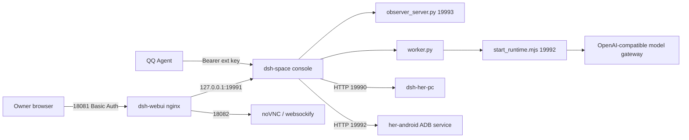

# DSH Space / 小鲸鱼空间

一个**只接受本机 owner 指令**的本地 AI 空间：控制台、DSH 运行时、长期记忆、预算、独立思考观察、任务队列，以及她的桌面（Linux X11 容器）和手机（ADB 真机）设备桥。

> 这是一个部署快照，不是官方托管服务。所有服务都应当只暴露在局域网/本机，不要直接把 19991 或 19992 开放到公网。

## 包含什么

| 目录 | 内容 |
|---|---|
| `space/` | 空间本体：控制台 `space.py`、任务执行 `worker.py`、思考观察、记忆、预算、双人格、运行时策略、Web UI（`dist/`）、DSH 运行时集成 |
| `deploy/space/` | 空间容器镜像、compose 示例、入口脚本、配置/定时任务示例 |
| `deploy/webui/` | nginx 网关模板（Basic Auth、SSE、noVNC 代理、owner 代理签名） |
| `deploy/desktop/` | 她的桌面容器：Xvfb + openbox + Chromium + x11vnc + websockify + 固定动作 agent |
| `deploy/phone/` | 她的手机服务：Android 真机 ADB 固定动作 API、systemd、防火墙 |
| `integrations/qq-agent/` | 可选：QQ Agent 调用空间的委托技能 |
| `docs/` | 架构、部署、各服务说明、安全与去敏说明 |

## 架构



关键点：

- 控制台只监听容器内 `19991`，再由宿主只发布到 `127.0.0.1:19991`；浏览器只走 nginx 网关。
- nginx 网关用 Basic Auth 保护浏览器入口，并用 `X-DSH-Proxy-Authorized` 给控制台签发 owner Cookie；SSE 端点只靠 Cookie，不需要第二次 Basic Auth。
- 任务入口与任务信封 (`task_authority.py`) 强制「只有本机 owner 的指令算指令」，网页/文件/工具回执/记忆都只是资料。
- 空间运行时使用 DeepSeek Harness（DSH）的 `space` profile，只暴露经过 `runtime-policy.mjs` 白名单的 MCP 工具。
- 桌面和手机都是固定动作 API，不提供任意 shell 透传；手机服务再用 iptables 只允许空间宿主访问。

## 快速开始

完整步骤见 [docs/DEPLOYMENT.md](docs/DEPLOYMENT.md)。最小路径：

1. 准备一台 Linux 宿主（建议 2 核 / 4 GB 以上）安装 Docker 与 compose。
2. 构建空间镜像：

   ```bash
   cd deploy/space
   cp .env.example .env          # 填 DEEPSEEK_API_KEY、DSH_PROXY_SECRET、DESKTOP_HOST
   cp ../../space/config.example.json ../../space/config.json
   mkdir -p data workdir && sudo chown -R 1000:1000 data workdir
   docker compose -f docker-compose.example.yml up -d --build
   ```

3. 网关：

   ```bash
   cd deploy/webui
   cp .env.example .env          # DSH_PROXY_SECRET 与空间保持一致
   htpasswd -c htpasswd admin
   . ./.env && ./render-nginx.sh
   docker compose -f docker-compose.example.yml up -d
   ```

   浏览器打开 `http://<空间宿主>:18081`。

4. 桌面（可在另一台 Linux 宿主）：

   ```bash
   cd deploy/desktop
   cp .env.example .env          # DESKTOP_HOST、SPACE_HOST、HER_AGENT_TOKEN
   mkdir -p home
   docker compose -f docker-compose.example.yml up -d --build
   ```

   把同一个 `HER_AGENT_TOKEN` 写入空间宿主的 `deploy/space/data/her-agent.token`。

5. 手机（插在桌面宿主或另一台 Linux 宿主）：

   ```bash
   cd deploy/phone
   sudo HER_ANDROID_ALLOW_IP=<空间宿主 IP> ./install.sh
   ```

   把 `/etc/her-android/token` 的内容写入空间宿主的 `deploy/space/data/android.token`，并确保 `adb devices` 能看到设备。

6. 可选：QQ Agent 接入，见 [docs/QQ-AGENT.md](docs/QQ-AGENT.md)。

## 目录中的运行时文件

以下内容**不在仓库里**，部署时生成或自行准备：

- `space/config.json`（从 `config.example.json` 复制并修改）
- `deploy/space/data/`：`space.sqlite`、`ext.key`、`bridge.key`、`owner-http.key`、`observer-http.key`、`her-agent.token`、`android.token`、`schedule.json` 等
- `deploy/space/workdir/`：工作区
- `deploy/webui/htpasswd`、`deploy/webui/nginx.conf`
- `deploy/desktop/home/`
- 模型 API Key、SMTP 授权码、QQ 账号/token

## 安全

- 不要把 `19991`、`19992`、`19990` 直接映射到公网；网关只开在局域网。
- 所有 token 用 `secrets.token_urlsafe(32)` 生成，权限 600。
- 手机服务用 iptables 只允许空间宿主 IP；桌面 agent 用 `HER_ALLOWED_IP` 限制来源。
- 详细威胁模型与检查表见 [docs/SECURITY.md](docs/SECURITY.md)。

## 许可与名称

- 代码：Apache License 2.0，见 [LICENSE](LICENSE)。
- 名称、鲸鱼形象与「小鲸鱼」人设：见 [TRADEMARK.md](TRADEMARK.md)。
- 第三方组件：见 [THIRD_PARTY_NOTICES.md](THIRD_PARTY_NOTICES.md)。
- 这是部署快照，不包含 DSH 上游包、模型权重或任何人的运行时记忆。
